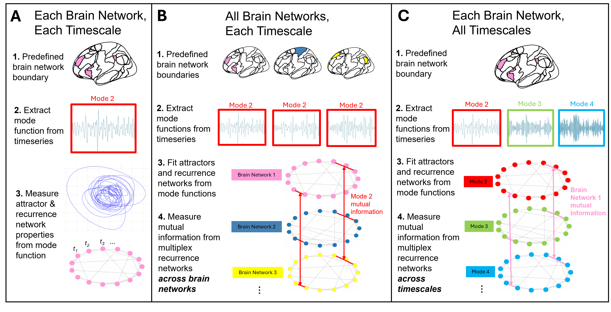

# Complex spatial and temporal organization of functional brain networks: A cybernetic framework for brain-behavior associations

This repository contains scripts used to perform data cleaning, group-level analyses, and plotting accompanying the manuscript "Complex spatial and temporal organization of functional brain networks: A cybernetic framework for brain-behavior associations," available as a [preprint](arxiv-link-here).

## Code

- **`run_MVMD.m`** – Subsets participants and extracts functional timeseries acquired using individualized parcellation (in our analyses, the data are 1200 TR × 400 parcel matrices per participant). These timeseries are decomposed using multivariate variational mode decomposition across parcels and averaged across networks for each participant. Central frequency information is also extracted and saved.
- **`rqa_mrn_metrics.R`** – Performs recurrence quantification analysis and multiplex recurrence network analysis across modes and brain networks, and saves results for each participant.
- **`data_sorting.R`** – Compiles results from `rqa_mrn_metrics.R` into sample-level datasets, and computes summary statistics for mode central frequencies.
- **`lme_analyses.R`** – Performs the group-level linear mixed-effects models and corrections reported in the manuscript and supplementary material.
- **`generate_plots.R`** – Generates Figures 3–7 in the manuscript.

## Usage

Run the scripts in the order listed above from a single working directory. Input and output locations are set in a "user settings" block at the top of each script (by default, outputs are written to `output/` and figures to `figures/`). `run_MVMD.m` writes `output/subject_ids.csv`, which defines the subject list and row order used by all later scripts.

## Dependencies

- **MATLAB:** `MVMD.m` (Rehman & Aftab, 2019)
- **R:** casnet, igraph, psych, e1071, tidyverse, lme4, lmerTest, broom.mixed, gt, patchwork, ggseg, ggsegYeo2011
